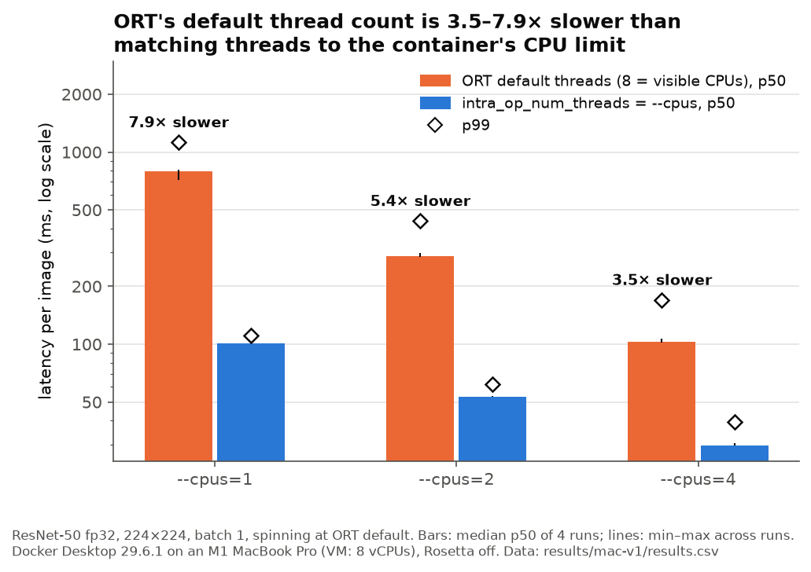
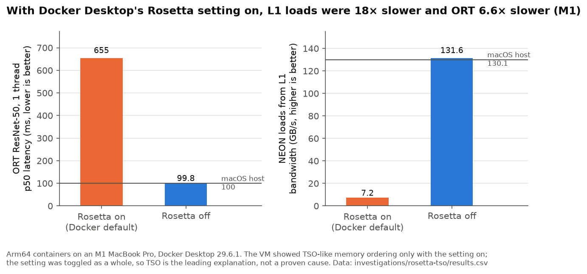

# onnx-docker-bench

**In Docker containers limited with `--cpus`, ONNX Runtime's default thread count made
ResNet-50 inference 3.5–7.9× slower (fp32, median p50) than setting
`intra_op_num_threads` to the CPU limit**, because ORT sizes its thread pool from the
8 CPUs the container can see, not from its CPU quota.

Measured on an M1 MacBook Pro under Docker Desktop (Linux VM with 8 vCPUs), ONNX
Runtime 1.31.0, 22 configurations × 4 runs; see [Limitations](#limitations).



## What to do about it

**Set `intra_op_num_threads` to the container's CPU limit.** Neither `os.cpu_count()`
nor the CPU affinity mask reflects `docker run --cpus`; the limit is in the cgroup:

```python
import math
import os

import onnxruntime as ort


def cgroup_cpu_limit() -> int | None:
    """CPUs allowed by the cgroup v2 quota (docker run --cpus), or None if unlimited."""
    try:
        quota, period = open("/sys/fs/cgroup/cpu.max").read().split()
    except OSError:
        return None
    return None if quota == "max" else max(1, math.ceil(int(quota) / int(period)))


opts = ort.SessionOptions()
opts.intra_op_num_threads = cgroup_cpu_limit() or os.cpu_count()
session = ort.InferenceSession("model.onnx", opts, providers=["CPUExecutionProvider"])
```

Only whole-CPU limits (1, 2, 4) were tested; rounding up for fractional limits is an
untested choice.

**If you can't control the thread count, turn off spinning.** It recovers most of
the loss, but not all of it:

```python
opts.add_session_config_entry("session.intra_op.allow_spinning", "0")
```

With ORT's default threads and spinning off, fp32 was 4.0×, 2.0× and 1.4× slower than
matched threads at 1, 2 and 4 CPUs (instead of 7.9×, 5.4× and 3.5×). Don't turn
spinning off once threads are matched: there it made latency 3–42% worse.

## Key results

Median p50 / p99 latency per image in ms over 4 runs. Every cell, with min–max across
runs, pooled p99, throttling and CPU time, is in
[docs/results_summary.md](docs/results_summary.md).

| model | `--cpus` | threads = `--cpus` | ORT default threads | slowdown (p50) | default threads, spinning off |
|---|---:|---|---|---:|---|
| fp32 | 1 | 101.3 / 111.0 | 796.1 / 1121.6 | 7.9× | 408.7 / 498.4 |
| fp32 | 2 | 53.4 / 62.1 | 287.3 / 436.9 | 5.4× | 106.2 / 172.9 |
| fp32 | 4 | 29.7 / 39.5 | 102.5 / 169.5 | 3.5× | 41.1 / 66.3 |
| int8 | 1 | 34.0 / 42.7 | 449.6 / 701.9 | 13.2× | 114.4 / 193.6 |
| int8 | 2 | 20.0 / 22.4 | 110.6 / 200.5 | 5.5× | 23.3 / 67.1 |
| int8 | 4 | 13.2 / 17.0 | 67.8 / 88.8 | 5.1× | 21.7 / 23.5 |

ResNet-50, 224×224, batch 1; "spinning" columns use ORT's default (`allow_spinning` = 1)
unless stated. int8 is ORT dynamic quantization (QInt8 weights); with matched threads
it was 2.2–3.0× faster than fp32 ([figure](docs/figures/fig4_fp32_vs_int8.png)).

**Why.** Inside the container ORT starts 8 threads (7 workers + the caller) whatever
`--cpus` says (`session_threads_added` = 7 in every default-thread run). With
spinning on, every default-thread run was throttled in 100% of the 100 ms CPU-quota
periods, against medians of 0–51% for matched threads
([figure](docs/figures/fig2_throttling.png)); with spinning off, all but one cell
(int8, 4 CPUs) still were. Once a container is throttled
in every period, its latency is its CPU time per inference divided by the limit:
mean latency ÷ (CPU time per inference ÷ `--cpus`) was 1.00 in 11 of the 12
default-thread cells. So the slowdown is extra CPU work: at 1 CPU, ORT's default
threads used 787 ms of CPU per fp32 inference against 101 ms with one thread.
Turning spinning off removed about half to three-quarters of that extra CPU (fp32:
787 → 428 ms at 1 CPU, 538 → 228 ms at 2 CPUs).

**Why int8 is hit harder at 1 CPU (13.2× vs 7.9×).** At 1 CPU the default threads
added 422 ms of CPU per int8 inference and 686 ms per fp32 inference. int8's useful
work is 3× smaller (34 vs 101 ms), but the added work is only 1.6× smaller, so it is
12.4× the useful work for int8 against 6.8× for fp32. Faster kernels shrink the
useful part more than the overhead; we did not measure why the overhead shrinks less.
The gap is not universal: at 2 CPUs the two models were hit equally (5.5× vs 5.4×).

**Tail latency.** Throttled runs' latencies cluster roughly one quota period (100 ms)
apart, consistent with work progressing only until each period's quota runs out
(fp32 at `--cpus=2`, default threads: clusters around 210, 294, 394 and 492 ms). With spinning off, the distribution splits in two
(86% near 106 ms, 14% near 166 ms), which is why its p50 can jump between runs
([figure](docs/figures/fig3_distributions_cpus2.png)).

## Bonus: Docker Desktop's Rosetta setting slowed native arm64 containers ~6.6× (M1)

With "Use Rosetta for x86_64/amd64 emulation on Apple Silicon" on (Docker Desktop's
default), ORT ran ResNet-50 at 655 ms per image on 1 thread in a container, against
99.8 ms with the setting off and 100.0 ms natively on macOS. Loads from L1 cache were
18× slower (7.2 vs 131.6 GB/s), while register-only arithmetic and stores were
unaffected. A message-passing litmus test saw no memory reorderings in ~860 million
samples with the setting on and ~50% with it off: the VM ran with x86-like (TSO)
memory ordering, which is reportedly how Apple's hypervisor supports Rosetta.



Caveats:

- **Correlation, not isolation.** Toggling the setting flipped the memory ordering and
  the slowdown together; TSO was never switched on its own, so it is the leading
  explanation, not a proven cause.
- **The size is surprising.** Published measurements of Apple's TSO mode on native
  code report costs typically within 3%, and 9–22% suite averages in earlier work
  ([Khayet & Morrison, ASPLOS '26](https://www.cs.tau.ac.il/~mad/publications/asplos2026-TSO.pdf)).
  An 11–18× drop in load throughput is far outside that.
- **M1 only**, Docker Desktop 29.6.1. Other chips or hypervisors may differ.

Details, sources and the test programs: [investigations/rosetta-tso/](investigations/rosetta-tso/README.md).
Practical upshot: benchmark arm64 containers on Apple Silicon with that setting off.

## Methodology

What was held fixed or controlled:

- **One image, one build.** `python:3.12-slim` pinned by digest, onnxruntime frozen at
  1.31.0, numpy 2.4.6; only the CPU execution provider (checked per run).
- **The same model files.** ResNet-50 exported once with torch's dynamo exporter
  (opset 18, random weights) and quantized once; every row records the model's SHA-256.
- **Only `sess.run` is timed** (`time.perf_counter`, one sample per iteration), with
  a fixed-seed input created beforehand, 50 untimed warmup iterations, garbage
  collection paused, and numpy's OpenBLAS threads capped so they don't inflate
  thread counts.
- **Each run is a fresh container.** The thread count ORT actually started, the
  cgroup CPU quota, throttling and CPU usage across the timed loop are recorded in
  every row. Raw per-iteration timings are saved for every run.
- **Interleaved, randomized order.** Each of the 4 repeat rounds ran all 22 cells in
  a fresh random order from a fixed seed, so drift over the ~2.5 h run spreads across
  cells instead of lining up with one setting.
- **Machine state recorded** before each stage (`results/mac-v1/machine-*.json`,
  `run-start.txt`): Docker VM size, Rosetta off, power source, idle state.

Statistics, following [docs/EXPERIMENT_PLAN.md](docs/EXPERIMENT_PLAN.md):

- **The unit of replication is the run,** not the iteration: iterations within a
  throttled run are not independent (see the clustering above).
- **Each cell was run 4 times,** with up to 1000 timed iterations per run (at least
  300); 3 slow cells were capped by a 300 s time limit per run. Tables report the
  median across runs with min–max. With 4 runs, the [min, max] range covers the
  median run with 87.5% probability.
- **A p99 from 1000 iterations rests on ~10 samples** (distribution-free 95% CI spans
  roughly the p98.3–p99.7 ranks), so pooled p99s over all 4 runs are also reported.
- **What changed from the plan, and why,** is in "Mac v1 deviations" in the plan.

## Limitations

- **Docker Desktop on a Mac, not Linux on bare metal.** Containers run in a Linux VM
  whose 8 vCPUs macOS schedules across 4 performance and 4 efficiency cores, with
  Docker Desktop's cgroupfs driver. Absolute latencies, and possibly the size of the
  penalty, will differ on native Linux servers. Cloud runs on arm64 and x86_64 Linux
  are planned for v2 ([cloud/](cloud/README.md): prepared, not yet run on real AWS).
- **One machine, M1 only.**
- **The penalty depends on conditions we didn't fully control.** The most
  oversubscribed cell (fp32, 1 CPU, default threads) varied 713–806 ms across its 4
  runs, against at most 3% for any matched-thread cell. In
  [exploratory runs](results/mac-exploratory/README.md) earlier the same day it took
  1099–1206 ms (about 11× instead of 7.9×). Per-run host load wasn't recorded, so we
  can't attribute the variation; read the slowdown factors as "about", not exact.
- **Power changed mid-run.** The first 16 runs ran on battery, the rest on AC. 12 of
  the 16 affected cells were within 2% of their AC runs; the others are noisy
  default-thread cells with no consistent direction
  ([results/mac-v1/README.md](results/mac-v1/README.md)).
- **Not an idle machine.** The window server and a desktop chat app used about a
  quarter of a core each while it ran.
- **Random weights.** Latency doesn't depend on weight values for these dense
  kernels, but the int8 model's accuracy is unknown; it is a latency comparison only.
  Only dynamic quantization was tested.
- **Narrow scope.** One model, 224×224, batch 1, whole-CPU limits, ORT's default
  sequential execution mode, one ORT version. 448×448 inputs are deferred to v2.
- **Phase 1 numbers are superseded.** The earliest runs
  ([results/mac-rosetta-on/](results/mac-rosetta-on/README.md)) were made with the
  Rosetta setting on and showed a smaller penalty (3.3× at 2 CPUs). Slower kernels
  diluted the overhead.

## Reproduce

Requires Docker, Python 3.12 and, on Apple Silicon, Docker Desktop's Rosetta setting
turned off.

```bash
python3 -m venv .venv
.venv/bin/pip install -r requirements-dev.txt
.venv/bin/python scripts/export_model.py      # models/resnet50.onnx (the measured files' sha256: cloud/models.sha256)
.venv/bin/python scripts/quantize_model.py    # models/resnet50.int8.onnx
python3 scripts/run_matrix.py matrices/mac-v1-pilot.json --build
python3 scripts/record_machine.py --stage main --out-dir results/mac-v1
caffeinate -dimsu python3 scripts/run_matrix.py matrices/mac-v1.json --estimates results/mac-v1/pilot.csv
.venv/bin/python scripts/analyze.py           # docs/figures/*.png, docs/results_summary.md
```

`caffeinate` is macOS-only; drop it elsewhere. The runner can be interrupted and
re-run: it skips runs already in the CSV. To run a single benchmark:
`.venv/bin/python bench/run.py --help`, or `scripts/run_one.sh` for one container.

Repository map: `bench/run.py` (the benchmark), `scripts/` (export, quantize, matrix
runner, machine record, analysis), `matrices/` (experiment definitions), `results/`
(data, one folder per study), `docs/` (plan, figures, summary),
`investigations/rosetta-tso/`, `cloud/` (v2, not yet run). MIT licensed.
